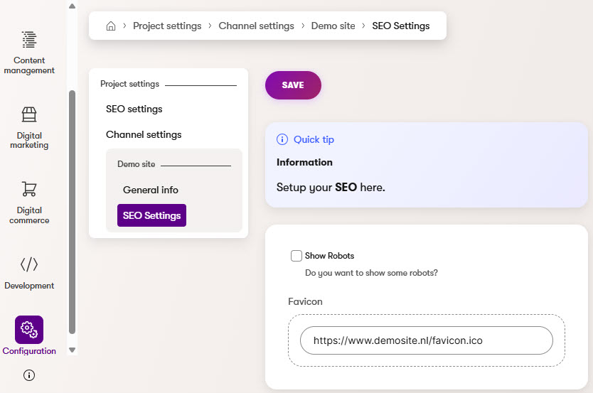

# Xperience Community: Project Settings

A comprehensive settings management system for Xperience by Kentico applications, supporting both **global settings** and/or **channel-specific settings** with automatic fallback.



> **⚠️ Internal API Warning:** This library depends on `Kentico.Xperience.Admin.Base.Forms.Internal`. This namespace is not part of Kentico's public API surface and may change between Xperience by Kentico versions without notice. Upgrading to a newer version of Xperience by Kentico may temporarily break this library until a compatible update is released.

## Description

This module provides strongly-typed project settings that can be:

- **Global** - Application-wide settings (stored with `channelId = 0`)
- **Channel-specific** - Per website channel settings with automatic fallback to global

Settings are managed through the Kentico admin interface and retrieved programmatically using ASP.NET Core's `IOptions<T>` pattern.

**Key Concept:** Whether settings are global or channel-specific is determined by which admin UI page you create. The same settings class can be used for both contexts.

## Requirements

### Library Version Matrix

| Xperience Version | Library Version |
| ----------------- | --------------- |
| >= 31.3.0         | 1.0.0           |

### Dependencies

- [ASP.NET Core 8.0](https://dotnet.microsoft.com/en-us/download)
- [Xperience by Kentico](https://docs.kentico.com)

## Package Installation

Add the package to your application using the .NET CLI

```powershell
dotnet add package XperienceCommunity.ProjectSettings
```

## Quick Start

### 1. Define Your Settings Class

Create a class that implements `IProjectSettingsType`:

```csharp
using XperienceCommunity.ProjectSettings.Classes;
using Kentico.Xperience.Admin.Base.FormAnnotations;

namespace MyProject.Settings;

public class SeoSettings : IProjectSettingsType
{
    public string SettingsSlug => "seo-settings";
    public string SettingsName => "Seo.Settings";
    public string SettingsDisplayName => "SEO Settings";
    public string SettingsExplanation => "Configure SEO settings for your website.";

    [TextInputComponent(Label = "Meta Title Suffix", Order = 1)]
    public virtual string MetaTitleSuffix { get; set; } = "";

    [CheckBoxComponent(Label = "Enable Open Graph", Order = 2)]
    public virtual bool EnableOpenGraph { get; set; } = true;
}
```

### 2. Register in Program.cs

```csharp
using XperienceCommunity.ProjectSettings;

builder.Services.AddProjectSettings<SeoSettings>();
```

### 3. Create Admin UI Pages

See the [Usage Guide](./docs/Usage-Guide.md) for detailed instructions on creating global and channel settings admin pages.

### 4. Use Settings in Your Code

```csharp
using Microsoft.Extensions.Options;

public class SeoService(IOptions<SeoSettings> settings)
{
    public string GetPageTitle(string baseTitle)
        => $"{baseTitle} {settings.Value.MetaTitleSuffix}";
}
```

## Full Instructions

View the [Usage Guide](./docs/Usage-Guide.md) for complete documentation including:

- Creating global and channel settings admin pages
- Settings resolution and fallback behavior
- Using both global and channel settings together
- Direct service access for multi-channel scenarios
- Available form components
- Key types reference
- Troubleshooting

## Contributing

Feel free to submit issues or pull requests to the repository, this is a community package and everyone is welcome to support.

## License

Distributed under the MIT License. See [`LICENSE.md`](./LICENSE.md) for more information.
